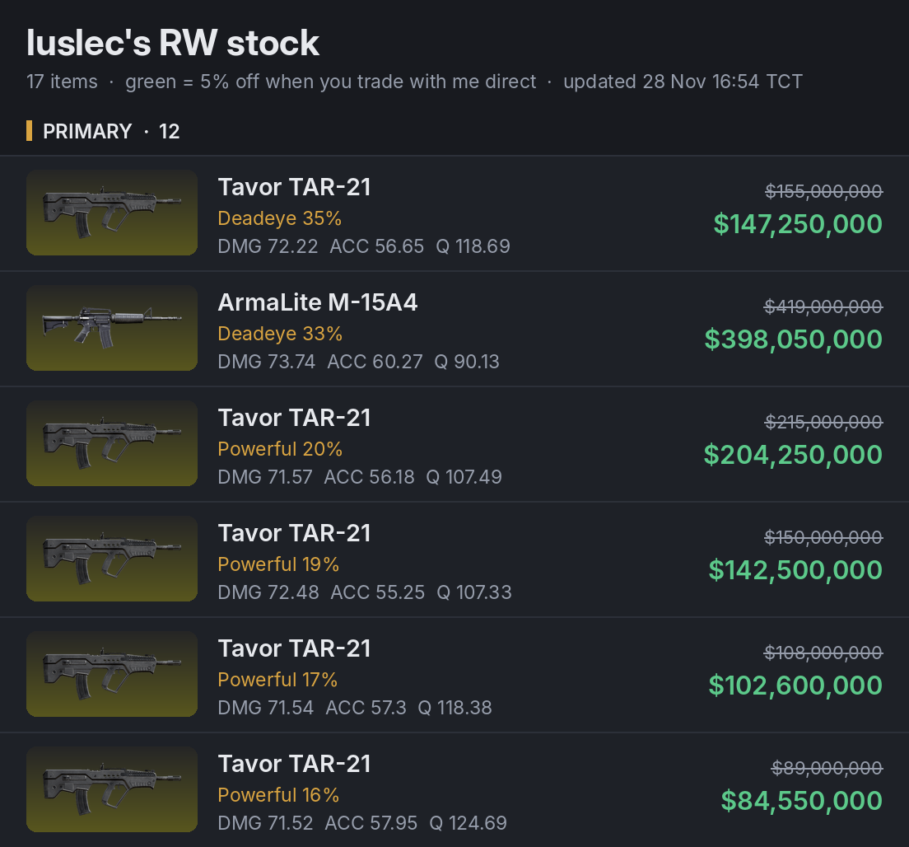
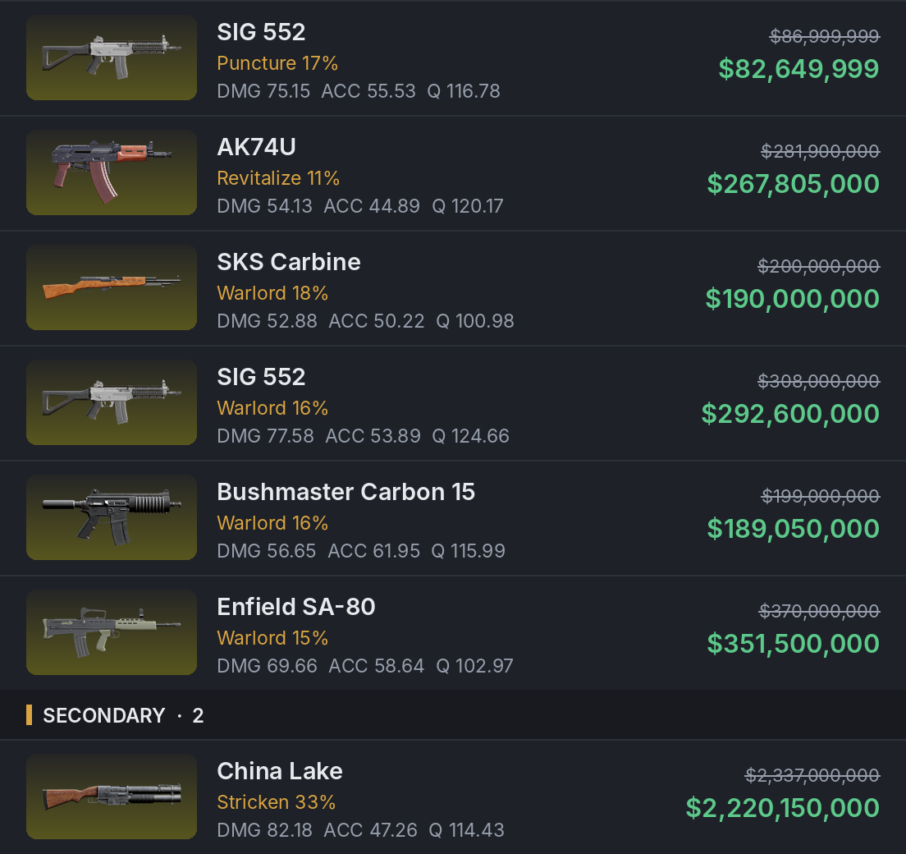
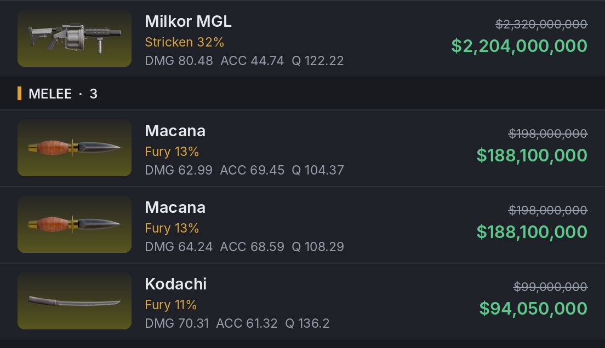

# RW stock images

Draws the RW weapons and armor listed on luslec's Torn item market as forum images, and refreshes them every hour with GitHub Actions. The image links never change, so the forum post updates itself.

## Setup

1. Make a new Torn API key at Torn → Settings → API Keys, with **Limited Access**.
2. In this repository, go to Settings → Secrets and variables → Actions → New repository secret. Name it `TORN_KEY` and paste the key.
3. Go to the Actions tab, open "Update stock images" and click **Run workflow**. It takes about a minute.
4. Check https://raw.githubusercontent.com/CharlesDataDev/rw-stock/images/stock-1.png

After that it runs on its own at 17 minutes past every hour.

## Forum code

All 10 lines stay in the post. Slots that aren't needed are blank 1-pixel images.

```html
<div style="line-height:0;font-size:0;margin:0 auto;padding:0;max-width:552px;">





</div>
```

## Settings

Add any of these in `.github/workflows/update.yml` under `env:`, below `TORN_KEY` (for example `DIRECT_DISCOUNT: "0.1"`):

- `DIRECT_DISCOUNT`: discount shown in green, as a fraction (default `0.05` = 5%).
- `IMAGE_SLOTS`: how many image files to write (default `10`). If you raise it, add matching lines to the forum code.
- `OWNER_NAME`: name in the header (default `luslec`).
